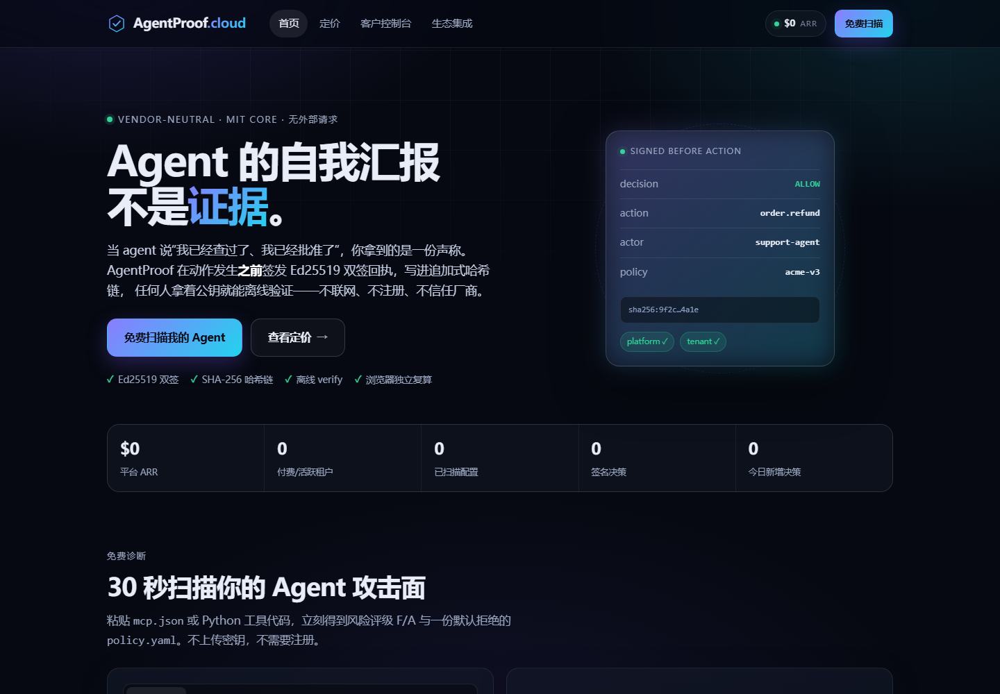
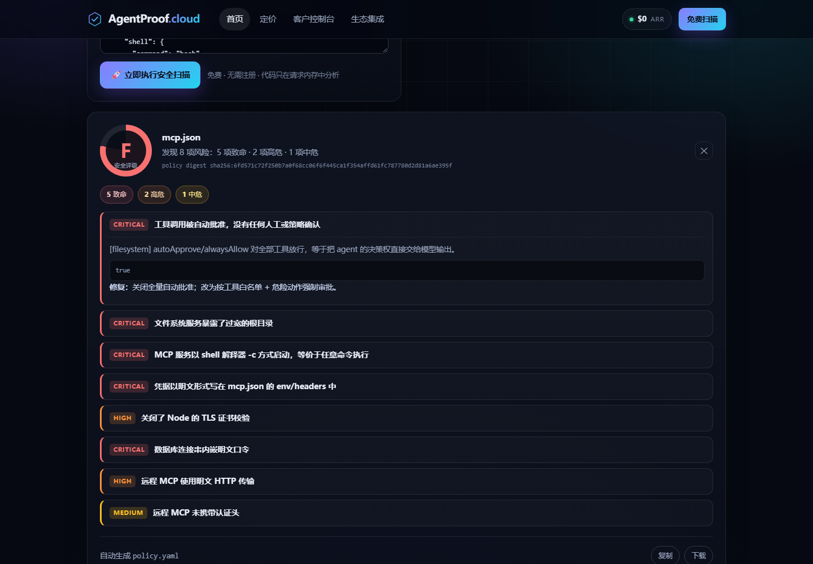
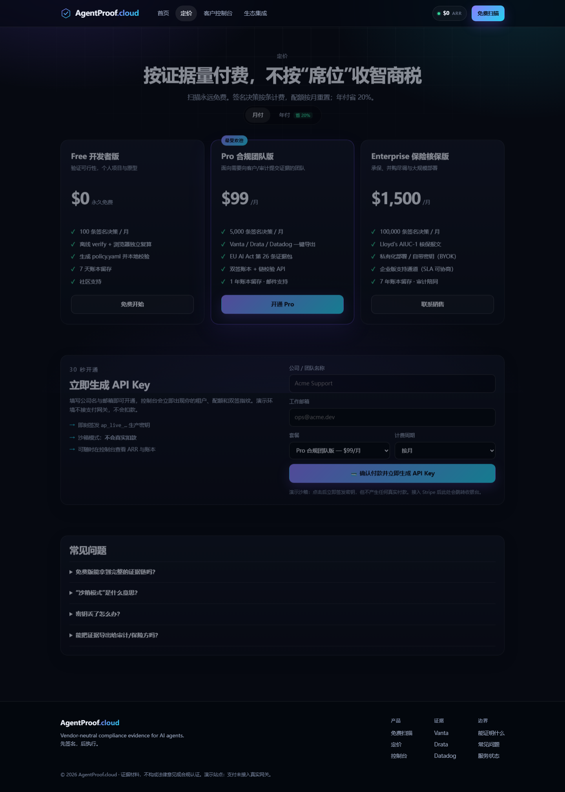
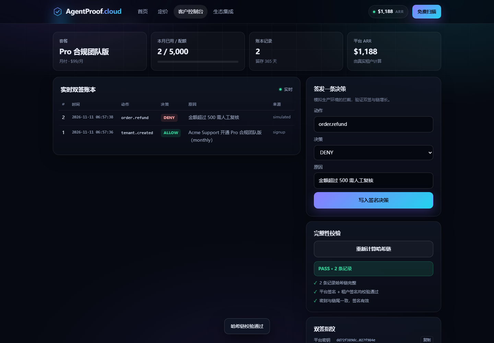
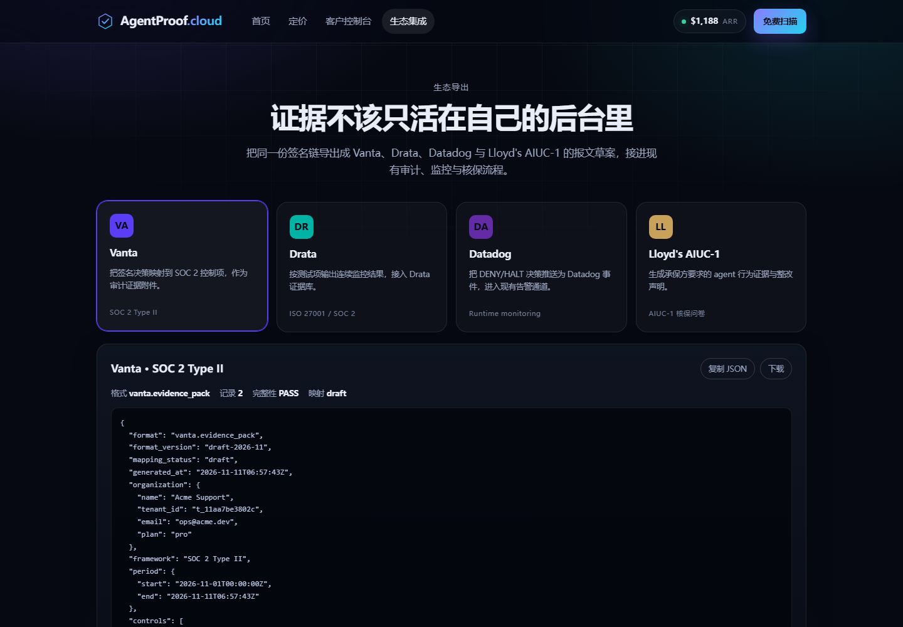

# AgentProof.cloud

**Vendor-neutral compliance evidence for AI agents — commercial site + self-serve SaaS portal.**

**Live static preview:** <https://yepinggu66.github.io/agentproof-cloud/> — the browser scanner and the labelled offline demo work; the API is not deployed there.
**Source:** <https://github.com/yepinggu66/agentproof-cloud>

An agent's own account of what it did is a claim, not evidence. This repository
is the commercial half of that idea: a four-view marketing/SaaS website, a free
online scanner that analyses real `mcp.json` and Python tool code, self-serve
tenant onboarding with API keys, a dual-signed (Ed25519) hash-chained ledger,
and mapping-draft exports for Vanta / Drata / Datadog / Lloyd's AIUC-1.

```
  site/                 the static, self-contained commercial site (4 views)
  server/               FastAPI service: scanner, tenants, signed ledger, exports
  tools/leadgen.py      batch read-only scan of public GitHub agent repos
  docs/launch-copy.md   launch drafts + pre-publish NO-GO checklist
  scripts/              local runner + Playwright screenshot capture
  tests/                40 tests incl. JS/Python scanner parity and tamper detection
  Dockerfile            single-image deployment (site + API + SQLite volume)
  railway.json          Railway one-click deploy config
  netlify.toml          static-only publish config for the marketing site
```

## The four views

| View | Route | What it does |
|---|---|---|
| 官网首页 + 免费扫描器 | `#/home` | Paste `mcp.json` or Python agent code → live risk grade (A–F), per-finding evidence, generated deny-by-default `policy.yaml` |
| 定价 + 自助开户 | `#/pricing` | $0 / $99 / $1,500 tiers, monthly/annual, creates a tenant, issues `ap_live_…` key, ARR rises in the header |
| 客户控制台 | `#/console` | Quota, live ledger (ALLOW/HALT/DENY), platform + tenant key fingerprints, chain verification, simulated decisions |
| 生态导出中心 | `#/integrations` | Vanta / Drata / Datadog / Lloyd's AIUC-1 payload drafts with integrity + disclaimer |



> 截图中的租户 “Acme Support”、$1,188 ARR 与账本记录均为本地演示数据，不是真实客户或收入。









## Quick start

```bash
python -m venv .venv && . .venv/bin/activate      # Windows: .venv\Scripts\activate
pip install -r requirements.txt
python -m uvicorn server.app:app --host 127.0.0.1 --port 8791
# open http://127.0.0.1:8791
```

Or on Windows:

```powershell
powershell -ExecutionPolicy Bypass -File scripts\run_local.ps1
```

The service serves `site/` at `/` and the JSON API at `/api/*`. Data (SQLite)
and signing keys live in `data/` by default; override with `AGENTPROOF_DATA_DIR`.

### Static-only preview

Open `site/index.html` directly (or publish `site/` to Netlify). The scanner,
pricing, checkout and console all keep working in a clearly-labelled offline
demo mode: the browser contains a port of the same scanner (byte-identical
`policy.yaml`, verified by `tests/test_scanner_parity.py`), and the console
keeps a localStorage ledger with SHA-256 preview signatures. The site detects
the backend automatically and switches to LIVE mode when it is reachable.

## API

| Method | Path | Auth | Purpose |
|---|---|---|---|
| GET | `/api/health` | – | Liveness + ARR + counters |
| GET | `/api/plans` | – | Plan catalogue (used by the pricing view) |
| GET | `/api/stats` | – | Platform counters (home page strip) |
| POST | `/api/scan` | – | Analyse MCP config / Python code; free, rate-limited per IP |
| POST | `/api/signup` | – | Create tenant, issue API key, sandbox checkout |
| POST | `/api/login` | – | Resolve a key to a tenant |
| GET | `/api/me` | `X-API-Key` | Tenant, usage/quota, fingerprints |
| GET | `/api/ledger?limit=50` | `X-API-Key` | Newest-first signed records |
| POST | `/api/ledger/simulate` | `X-API-Key` | Append a signed decision (quota enforced) |
| GET | `/api/verify` | `X-API-Key` | Recompute chain + both signatures + seal |
| GET | `/api/export/{vendor}` | `X-API-Key` | `vanta` / `drata` / `datadog` / `aiuc1` |
| GET | `/api/arr` | – | ARR / MRR roll-up |

Auth accepts `X-API-Key: ap_live_…` or `Authorization: Bearer …`.
Every error is machine-readable: `{"error": {"code": "...", "message": "..."}}`.

## What the ledger actually does

Each record stores a canonical JSON body, its SHA-256 hash, the previous hash,
and **two** Ed25519 signatures over that body: platform key and tenant key.
Verify re-derives the body, checks the hash chain, both signatures, and a seal
that commits to the chain tail. Tampering with a field, deleting a record,
reordering, or re-signing the whole chain with a different key is covered by
`tests/test_api.py` (tamper + delete) and inspection of the seal.

Tenant private keys are encrypted at rest with a locally generated Fernet
master key (`data/master.key`); only the API key's SHA-256 digest is stored.

## Honest boundaries (please read before selling this)

1. **Payments are not wired.** Signup creates a real tenant and key but takes
   no money (`checkout.mode = "sandbox"`). To charge, create a Stripe Checkout
   session in `POST /api/signup` before issuing the key; set
   `AGENTPROOF_CHECKOUT_MODE=live` in your deployment once implemented.
2. **Vendor exports are mapping drafts.** Field names follow public docs; they
   are not certified integrations. Each payload says so.
3. **Shapes of evidence, not a legal opinion.** Signatures prove issuance and
   integrity; they cannot prove a decision was correct or that a record was
   never fabricated by the key holder. Publish the seal out of band for that.
4. **Single-process SQLite.** Fine for a demo and small teams; a real multi-
   worker deployment needs Postgres and a serialized append.
5. Keys and API-key namespaces (`ap_live_` / `ap_free_`) are local conventions;
   there is no KMS in this build.

## Tests

```bash
pip install -r requirements-dev.txt
python -m pytest            # 37 tests, ~1s (needs Node.js for parity tests)
python scripts/screenshot_preview.py http://127.0.0.1:8791 .tmp/shots
```

The suite covers: scanner grades and policy validity, generated YAML is
deny-by-default, JS/Python scanner parity (grade, findings, capabilities and
policy byte equality), tenant/key issuance, auth, quota, rate limiting, ledger
append + verify, tamper/delete detection, and all four export formats.

## Lead generation (optional tooling)

`tools/leadgen.py` reads public GitHub repositories (read-only API, no clone, no
dependency install, no execution of target code), runs the same scanner that
powers the website, and writes a per-repository report plus a lead list:

```bash
python tools/leadgen.py --search "mcp server in:name" --limit 10
python tools/leadgen.py --repos owner/repo,owner/repo2 --max-files 6
```

Outputs: `leads.csv`, `summary.md`, `summary.json`, `reports/<owner>__<repo>.md`.
Secret-looking values are redacted before writing; reports carry an explicit
"static analysis, not exploit proof" disclaimer and an opt-out line. Use it
only for public code or code a recipient shares with you — never auto-send.

Launch copy drafts (Show HN, Product Hunt, cold email, objection handling and
an honest pre-publish checklist) live in [docs/launch-copy.md](docs/launch-copy.md).
They are marked **pre-publish / NO-GO** until the public URL is live and the
checklist is green.

## Deploy

### Railway (site + API + volume)

```bash
railway init
railway up          # builds the Dockerfile
railway volume add  # mount at /data
```

`railway.json` sets the healthcheck to `/api/health` and the start command to
`uvicorn server.app:app --host 0.0.0.0 --port $PORT`.

### Any Docker host

```bash
docker build -t agentproof-cloud .
docker run -p 8080:8080 -v agentproof-data:/data agentproof-cloud
```

### GitHub Pages (static preview, already live)

The public preview is published from the `gh-pages` branch: `git subtree split
--prefix=site -b pages-build` then `git push origin pages-build:gh-pages`.
`site/.nojekyll` keeps Jekyll out of the way. Automatic Actions-based deploys
need a token with the `workflow` scope, which the current `gh` login does not
have; refresh with `gh auth refresh -s workflow` to enable that later.

### Netlify (static marketing site only)

Build command: none. Publish directory: `site`. The site runs in offline demo
mode there; the live API requires the Docker service.

## License

MIT (see `LICENSE`). Demo data, keys and tenants are wiped by deleting `data/`.
